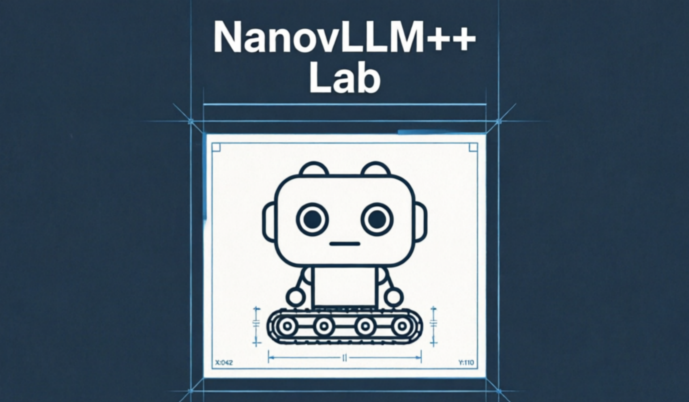

<p align="center">

</p>

# Nano-vLLM++ Lab

A lightweight vLLM implementation built from scratch, based on
[nano-vLLM](https://github.com/GeeeekExplorer/nano-vllm) by Xingkai Yu.
This fork is a personal learning project that extends the original with the features below.

## New Features vs Source Repo

- **[Feature] Data Parallelism (DP)** — scale out across GPUs with `data_parallel_size`; each replica runs its own scheduler and model runner, while a controller dispatches batches and gathers results.
- **[Feature] Profiler** — per-step CPU/CUDA profiling with configurable warm-up and active steps; traces are written to `profiler_output` for TensorBoard.
- **[Model] Qwen3.5 architecture** — support for the hybrid GDN (linear attention) + full-attention layout, including VL composite checkpoints whose text config is nested under `text_config`.

## Installation

Requires Python 3.10–3.12 and a CUDA-capable GPU. Clone this repository, then:

```bash
pip install -e .
```

`flash-attn` is installed as a dependency. Building it from source can take a while; a
prebuilt wheel matching your CUDA / PyTorch versions will be much faster.

## Model Download

To download the model weights manually, use the following command:

```bash
pip install modelscope
python -c "
from modelscope import snapshot_download
snapshot_download('Qwen/Qwen3-0.6B', local_dir='./huggingface/Qwen3-0.6B/')
"
```

To experience the Hybrid model, download:

```bash
python -c "
from modelscope import snapshot_download
snapshot_download('Qwen/Qwen3.5-0.8B', local_dir='./huggingface/Qwen3.5-0.8B/')
"
```

## Quick Start

See `example.py` for usage. The API mirrors vLLM's interface with minor differences in the `LLM.generate` method:

```python
from nanovllm import LLM, SamplingParams
llm = LLM("/YOUR/MODEL/PATH", enforce_eager=True, tensor_parallel_size=1)
sampling_params = SamplingParams(temperature=0.6, max_tokens=256)
prompts = ["Hello, Nano-vLLM++ Lab."]
outputs = llm.generate(prompts, sampling_params)
outputs[0]["text"]
```

## Benchmark

See `bench.py` for benchmark.

New baseline numbers for this fork are being measured — coming soon.

---

*Feature descriptions are being expanded and will be published soon.*
